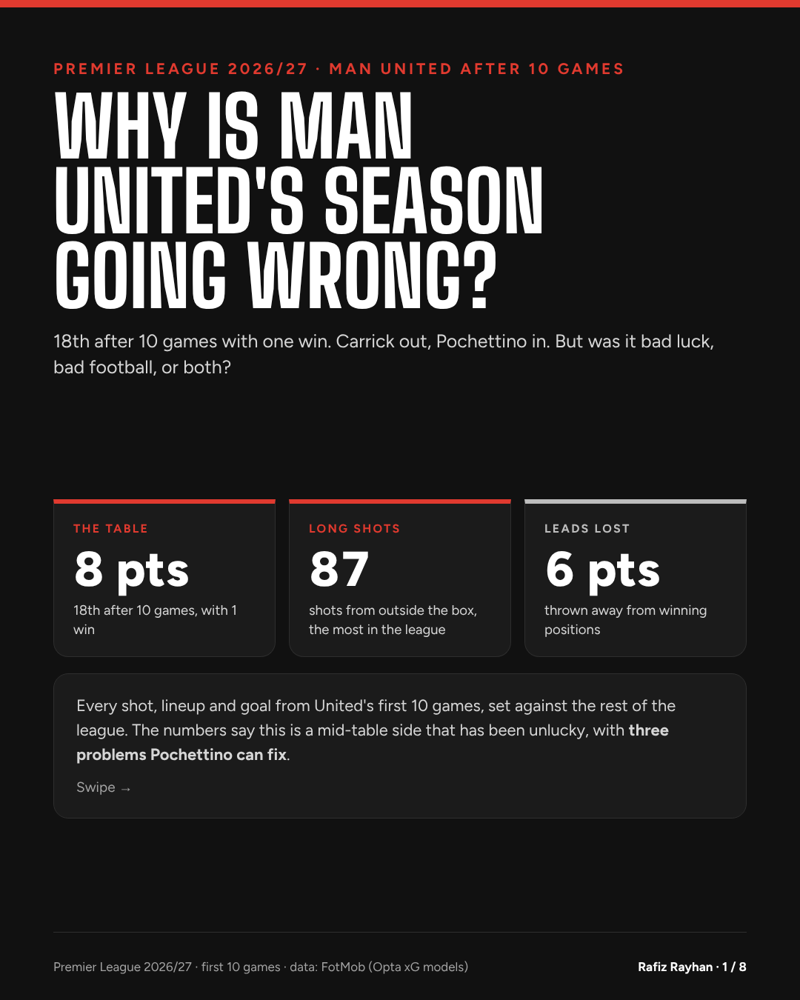

# Why is Man United's season going wrong? (Premier League 2026/27, first 10 games)

Man United were 18th after 10 games, with 8 points and one win. Michael Carrick was sacked on 12 November and Mauricio Pochettino starts on 18 November. This project asks a simple question: **was it bad luck, bad football, or both?**

It uses every shot, lineup, goal and substitution from the first 100 Premier League matches (FotMob data, Opta xG models) and compares United with the rest of the league.



## Findings

| # | Finding | Key numbers |
|---|---|---|
| 1 | **Unlucky, and not good enough either** | 8 points from chances worth 12.9 expected points (12th, not 18th). xG 18.0 for, 18.0 against. The 3rd-biggest shortfall in the league |
| 2 | **Too many long shots** | 46% of shots from outside the box (league 35%), the most in the league. 0.09 xG per shot, 18th of 20. Fernandes and Cunha: 29 of their 50 shots from distance |
| 3 | **Few shots allowed, but big chances** | 77 open-play shots conceded (6th fewest), but 0.14 xG per shot, the worst in the league. Not counter-attacks: 13th for fast-break chances conceded |
| 4 | **Losing at both ends of set pieces** | 1 goal from 48 set-piece shots (17th for set-piece xG). 6 of the 19 goals conceded came from set pieces, 4 from inside the six-yard box |
| 5 | **Can't hold a lead** | Led in 4 games, won 1. In the three draws: 7 shots for v 20 against while ahead. Holding on would have meant 14 points and 9th |
| 6 | **It wasn't the substitutions** | All four changes made while ahead in those games were like-for-like, including two forwards brought on at Everton at 1-0 |

The full carousel is in [`out/Man_United_Why_Is_It_Going_Wrong.pdf`](out/Man_United_Why_Is_It_Going_Wrong.pdf).

## Method

**Expected points** (page 2) come from the xPts project: each match is simulated 10,000 times from both teams' shot xG, giving each team's expected points for that game. The table is in `data/xpts_table.csv`.

**Shot locations** use FotMob's coordinates (pitch 105 x 68 m, attacking towards x = 105). A shot is "outside the box" if it is more than 16.5 m from the goal line or more than 20.16 m from the centre of the goal.

**Set pieces** are shots FotMob tags as `FromCorner`, `SetPiece`, `FreeKick` or `ThrowInSetPiece`. **Open play** is `RegularPlay`, `IndividualPlay` and `FastBreak`. Penalties are counted separately.

**Game state** (pages 6 and 7) is rebuilt from the match events, so own goals and stoppage time are included. Each shot is placed on a match clock (first half 0 to 45 + added time, second half after that) and tagged with the score at that moment. Minutes in each state come from the same clock.

**Momentum** (page 7) is FotMob's minute-by-minute measure of which team is on top. Values are flipped for away games so that positive always means United.

**Substitutions** use FotMob's match events and each player's usual position (goalkeeper, defender, midfielder, forward).

### How penalties are handled

United scored 2 penalties (both Fernandes) and conceded 2.

| Page | Penalties |
|---|---|
| 2, expected points and xG | Included on both sides |
| 3, shooting | Excluded (191 non-penalty shots, 11 goals) |
| 4, defence | Excluded (open play only) |
| 5, set pieces | Not counted as set pieces |
| 6, leads lost | Included (actual goal times) |
| 7, season-wide note | Excluded: without penalties, United's xG while leading is 2.4 for and 2.6 against |

United's 14 league goals = 11 non-penalty goals + 2 penalties + 1 own goal.

## Limitations

- **Ten games is a small sample.** These are tendencies, not verdicts.
- **No pass-level data.** FotMob's free data has shots, team and player match stats, lineups and events, but not every pass. So the report can show *that* opponents get clear chances, not *how* each move broke United's midfield.
- **"Dribbled past"** counts are partly about who a player is asked to press. They can't show who was at fault for a goal.
- **The substitution check covers 3 games and 4 changes.** It supports the point; it doesn't prove it.
- **Player positions** are FotMob's usual position for each player, so a like-for-like change could still alter the shape slightly.

## Reproduce

```
pip install -r requirements.txt
playwright install chromium

python src/s0_download.py        # FotMob match files -> raw/fotmob_pl_2026_27/ (about 5 minutes)
python src/s1_team_stats.py      # team stats per match and league averages
python src/s2_players.py         # United player totals, shots and rotation
python src/s3_gamestate.py       # score at every shot, minutes in each state
python src/s4_pages.py           # the 8 pages and the PDF -> out/
```

`s0_download.py` opens FotMob in a real browser (Playwright) and saves the data each match page loads. If it finds no matches, run `python src/s0_download.py --show`.

## Files

| Path | Contents |
|---|---|
| `src/s0_download.py` | Downloads every finished 2026/27 match (shots, team stats, lineups, player stats, events) |
| `src/s1_team_stats.py` | `data/team_match_stats.csv`, `data/team_averages.csv` |
| `src/s2_players.py` | `data/mufc_player_matches.csv`, `data/mufc_players.csv`, `data/mufc_shots.csv` |
| `src/s3_gamestate.py` | `data/shots_gamestate.csv`, `data/gamestate_by_team.csv`, `data/united_goals.csv` |
| `src/s4_pages.py` | `out/page_1.png` to `out/page_8.png`, `out/Man_United_Why_Is_It_Going_Wrong.pdf` |
| `src/style.py` | Shared fonts, CSS and page layout |
| `data/xpts_table.csv` | Expected points table from the xPts project (input) |
| `fonts/` | Big Shoulders Display and Figtree (SIL Open Font Licence) |

The raw FotMob files are not included (`raw/` is in `.gitignore`). Run `s0_download.py` to fetch them.

## Data

FotMob (xG and xGOT by Opta). Personal, non-commercial analysis. Please don't republish the raw files.

Rafiz Rayhan · [GitHub](https://github.com/rafizrayhan) · [LinkedIn](https://www.linkedin.com/in/rafiz-rayhan)
